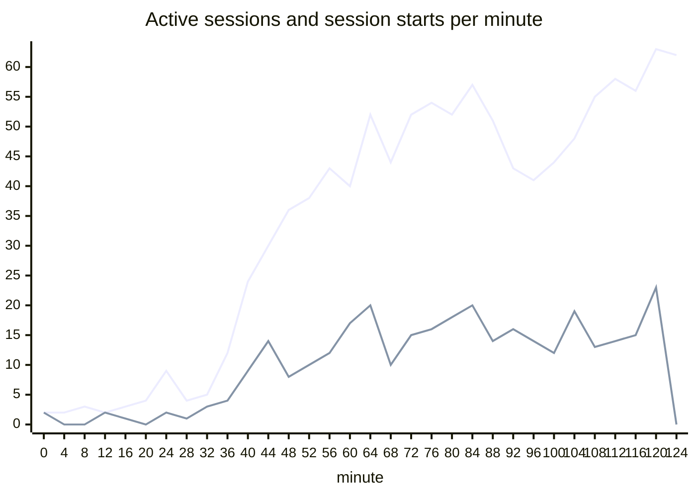
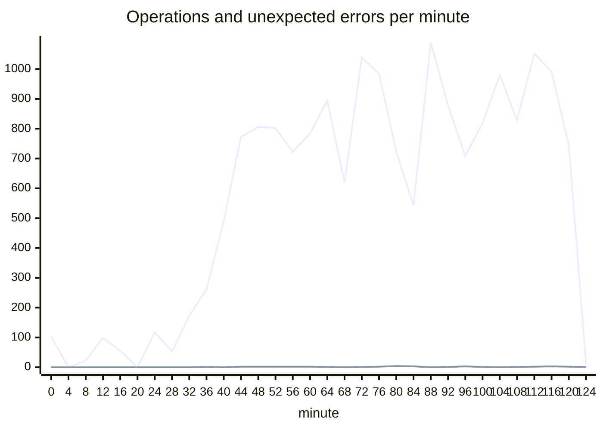
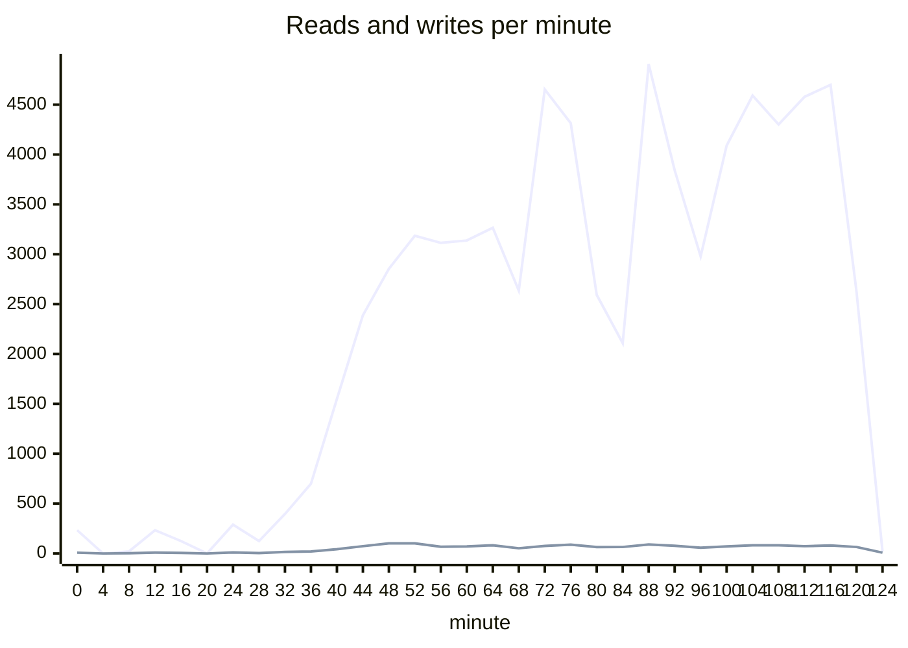

# Giggre load test — Stage 1: 1,000 users

Run `20261123211322-s1-72211c` · 2026-11-23T21:13:22.622Z → 2026-11-23T23:17:36.398Z · environment **emulator** (`demo-giggre-loadtest`)

Legend: **[measured]** observed during this run · **[estimate]** computed from the cost model or list prices · **[assumption]** configured workload input · **not tested** = no data.

## 1. Executive summary

**The run was aborted:** Unexpected error rate 5.2% over the last 60s exceeds 5.0%

- ABORTED: Unexpected error rate 5.2% over the last 60s exceeds 5.0%
- Emulator busy (CPU p90 121%, max 349%): slow results may describe the local emulator, not the app on Cloud Firestore

> **Emulator caveat.** This stage ran against the local Firebase Emulator Suite. It validates correctness, security rules, read/write volumes and contention behaviour. Its latencies reflect a single local Java process, **not** Cloud Firestore at scale, and the emulator does not enforce composite-index requirements or production quotas. Treat latency verdicts as indicative only.

## 2. Overall result

**FAIL (ABORTED)**

## 3. Test environment

| Item | Value |
|---|---|
| Environment | emulator (demo-giggre-loadtest) — not billable |
| Cloud Functions | not running (trigger load estimated only) |
| Generator processes | 3 on 12 CPU cores |
| Generator peak CPU / event-loop p99 / RSS | 30% / 79 ms / 500 MB [measured] |
| Emulator JVM CPU p90 / max / RSS | 121% / 349% / 1,229 MB [measured] — **busy** |
| Firebase JS SDK | client SDK, one app instance per virtual user, rules enforced |

## 4. Test configuration

| Setting | Value |
|---|---|
| Plan hash | `63eaf3e696e65c02` |
| Simulated day compressed into | 150 min (1 real min = 9.6 simulated min; sessions themselves run in real time) |
| Max concurrency / ops per second / registrations per min | 175 / 40 / 30 |
| Worker / host split | 80% / 20% [assumption] |
| Primary intents | browse 35%, explore 20%, apply 15%, chat 15%, post 10%, register 5% [assumption] |
| Seed data | 60 open gigs, 120 chat rooms, 958 returning accounts (setup writes 3,977, failures 0) |

## 5. Unique simulated users

1,000 planned (800 workers, 200 hosts, 42 registering during the day) · 1,596 sessions planned · 1,270 started, 1,183 completed, 34 failed [measured]

## 6. Peak concurrent users

82 concurrent sessions [measured] (plan expected 70, cap 175; sessions that waited for a free slot: 0)

## 7. Test duration

124.2 min real time (planned 150 min)



## 8–10. Operations

| | Count |
|---|---:|
| Total operations | 73,373 |
| Successful (incl. expected business-rule rejections) | 73,217 |
| Expected rejections (gig taken, already applied, …) | 158 |
| Unexpected failures | 156 (0.21%) |



## 11. Authentication performance

| Operation | Count | p50 | p95 | p99 | max | Expected rejections | Unexpected errors |
|---|---:|---:|---:|---:|---:|---:|---|
| auth.login | 1,267 | 5 ms | 12 ms | 24 ms | 44 ms | 34 | 0 (invalid-credentials:34) |
| auth.register | 38 | 5 ms | 8 ms | 13 ms | 13 ms | 1 | 0 (duplicate-account:1) |
| auth.tokenRefresh | 64 | 2 ms | 3 ms | 10 ms | 10 ms | 0 | 0 |
| register.createProfile | 37 | 645 ms | 2884 ms | 4058 ms | 4058 ms | 0 | 0 |
| register.referralCheck | 37 | 608 ms | 8510 ms | 8530 ms | 8530 ms | 0 | 0 |
| register.role | 37 | 665 ms | 2616 ms | 3682 ms | 3682 ms | 0 | 0 |
| register.userIdCheck | 37 | 445 ms | 5527 ms | 9104 ms | 9104 ms | 0 | 0 |

## 12. Gig browsing performance (list)

The app has one global listener for all open gigs (`open_gigs where status in [open, partially_filled]`, no limit). `browse.list` is the time to its first server snapshot. Average gigs delivered per session open: 73 reads [measured].

| Operation | Count | p50 | p95 | p99 | max | Expected rejections | Unexpected errors |
|---|---:|---:|---:|---:|---:|---:|---|
| browse.clientFilterMs | 853 | 0 ms | 0 ms | 0 ms | 1 ms | 0 | 0 |
| browse.list | 1,204 | 3513 ms | 59980 ms | 86585 ms | 107919 ms | 0 | 0 |
| gig.detail | 2,218 | 372 ms | 6383 ms | 15958 ms | 38749 ms | 0 | 0 |
| open.activeGig | 9,785 | 148 ms | 5221 ms | 9072 ms | 80674 ms | 0 | 0 |
| open.chatBadges | 3,647 | 2156 ms | 33416 ms | 52119 ms | 75790 ms | 0 | 0 |
| open.config | 5,063 | 730 ms | 9713 ms | 16791 ms | 43768 ms | 0 | 0 |
| open.content | 3,691 | 161 ms | 5165 ms | 8620 ms | 29482 ms | 0 | 0 |
| open.fcmRegister | 2,480 | 760 ms | 3780 ms | 7067 ms | 15546 ms | 0 | 0 |
| open.fcmTokens | 2,480 | 72 ms | 3895 ms | 7676 ms | 20539 ms | 0 | 0 |
| open.host | 6,012 | 2309 ms | 35144 ms | 52789 ms | 132643 ms | 0 | 0 |
| open.location | 954 | 766 ms | 3532 ms | 5200 ms | 8464 ms | 0 | 0 |
| open.misc | 1,228 | 485 ms | 6214 ms | 9872 ms | 28725 ms | 0 | 0 |
| open.onlineUsers | 1,204 | 3445 ms | 63810 ms | 90023 ms | 107961 ms | 0 | 0 |
| open.roomUnread | 264 | 668 ms | 10048 ms | 16488 ms | 47878 ms | 0 | 0 |
| open.setOnline | 957 | 716 ms | 3683 ms | 5446 ms | 12437 ms | 0 | 0 |
| open.skills | 1,197 | 27 ms | 8383 ms | 22278 ms | 47839 ms | 0 | 0 |
| open.userDoc | 4,969 | 6 ms | 10827 ms | 22818 ms | 53059 ms | 0 | 21 (unavailable:21) |
| open.worker | 10,886 | 354 ms | 8851 ms | 12678 ms | 129637 ms | 0 | 0 |

## 13. Google Maps performance

- **Backend geographic queries:** none exist. The map uses the same global open-gigs listener as the list and filters/clusters on the device. [measured from code]
- Client-side clustering cost for the loaded gig set, timed in Node as an indicator only (device numbers need the integration test): | Operation | Count | p50 | p95 | p99 | max | Expected rejections | Unexpected errors |
|---|---:|---:|---:|---:|---:|---:|---|
| map.clusterCpuMs | 472 | 0 ms | 1 ms | 2 ms | 4 ms | 0 | 0 |
| map.markersLoaded | 472 | 67 ms | 73 ms | 74 ms | 75 ms | 0 | 0 |

- **Google Maps Platform requests sent by this test: 0.** Map SDK rendering, marker bitmaps, camera movement and frame times are **not tested** here; run `templates/map_render_perf_test.dart` on a device (see the skill's reference/maps-device-testing.md).
- Real-world billable Maps usage comes from Places Autocomplete/Details on the three post-gig screens (no session token). Estimated for this day's 27 post sessions at ~4 autocomplete + 1 details each: $0.76 [estimate, assumption on keystroke bursts].

## 14. Gig posting performance

| Operation | Count | p50 | p95 | p99 | max | Expected rejections | Unexpected errors |
|---|---:|---:|---:|---:|---:|---:|---|
| gig.post | 19 | 1897 ms | 5389 ms | 5389 ms | 5389 ms | 0 | 0 |
| gig.post.pickWorker | 12 | 3512 ms | 12679 ms | 12679 ms | 12679 ms | 0 | 0 |
| gig.post.slots | 2 | 3045 ms | 3045 ms | 3045 ms | 3045 ms | 0 | 0 |
| gig.post.write | 19 | 1889 ms | 4018 ms | 4018 ms | 4018 ms | 0 | 0 |

Visibility of a new gig to other online workers (post → appears in another session's listener): p50 1 ms, p95 7 ms over 14 gigs [measured]

## 15. Gig application performance

| Operation | Count | p50 | p95 | p99 | max | Expected rejections | Unexpected errors |
|---|---:|---:|---:|---:|---:|---:|---|
| gig.accept | 94 | — | — | — | — | 0 | 94 (permission-denied:94) |
| gig.apply | 122 | 3064 ms | 22105 ms | 43086 ms | 117016 ms | 2 | 1 (already-assigned:2, lt-stopped:1) |
| gig.apply.notify | 278 | 880 ms | 2553 ms | 3484 ms | 3742 ms | 0 | 0 |
| gig.apply.read | 282 | 2 ms | 3642 ms | 10292 ms | 41271 ms | 0 | 0 |
| gig.apply.write | 279 | 1813 ms | 5049 ms | 7033 ms | 9011 ms | 0 | 0 |
| gig.decline | 9 | — | — | — | — | 0 | 9 (permission-denied:9) |
| gig.statusWatch | 114 | 2 ms | 2 ms | 5 ms | 11 ms | 0 | 0 |
| lifecycle.find | 791 | 1 ms | 2 ms | 6 ms | 46 ms | 0 | 0 |
| lifecycle.location | 36 | 2174 ms | 4645 ms | 5512 ms | 5512 ms | 0 | 0 |
| lifecycle.transition | 13 | 2545 ms | 5262 ms | 5262 ms | 5262 ms | 0 | 0 |
| race.apply | 160 | 11169 ms | 18632 ms | 20702 ms | 21398 ms | 0 | 0 |
| race.select | 45 | 3298 ms | 5298 ms | 5298 ms | 5298 ms | 15 | 10 (permission-denied:10, slot-full:15) |
| race.select.retries | 20 | 2 ms | 2 ms | 2 ms | 2 ms | 0 | 0 |
| race.selectLegacy | 10 | 1407 ms | 1556 ms | 1556 ms | 1556 ms | 5 | 0 (already-assigned:5) |

## 16. Chat performance

| Operation | Count | p50 | p95 | p99 | max | Expected rejections | Unexpected errors |
|---|---:|---:|---:|---:|---:|---:|---|
| chat.delivery | 59 | 101 ms | 3566 ms | 5577 ms | 5577 ms | 0 | 0 |
| chat.history | 25 | 26 ms | 3648 ms | 57211 ms | 57211 ms | 0 | 0 |
| chat.list | 1,039 | 1 ms | 1759 ms | 4901 ms | 26131 ms | 0 | 0 |
| chat.markSeen | 94 | 37 ms | 3816 ms | 7715 ms | 7715 ms | 0 | 0 |
| chat.open | 125 | 2 ms | 4068 ms | 35403 ms | 92916 ms | 0 | 0 |
| chat.peerListen | 12 | 37 ms | 3148 ms | 3148 ms | 3148 ms | 0 | 0 |
| chat.send | 124 | 761 ms | 5418 ms | 7765 ms | 8286 ms | 0 | 0 |
| chat.send.message | 124 | 147 ms | 2479 ms | 5278 ms | 5578 ms | 0 | 0 |
| chat.send.room | 124 | 564 ms | 2200 ms | 4531 ms | 5312 ms | 0 | 0 |

## 17. Firestore reads and writes

| | Measured (client SDK) | Plan estimate |
|---|---:|---:|
| Reads | 287,032 | 454,034 |
| …of which listener updates after first snapshot | 76,766 | |
| Writes | 6,556 | 13,880 |
| Deletes | 0 | |
| Callable invocations | 0 | |
| Cloud Functions reads (server side) | not measured | 25,212 [estimate] |

Top read sources [measured]:

| Source | Reads | Share |
|---|---:|---:|
| onlineUsersGlobal | 120,169 | 41.87% |
| openGigsGlobal | 92,334 | 32.17% |
| worker | 10,899 | 3.80% |
| activeGig | 9,798 | 3.41% |
| skills | 9,576 | 3.34% |
| content | 8,613 | 3.00% |
| config | 5,063 | 1.76% |
| userDoc | 5,000 | 1.74% |
| chatBadges | 3,847 | 1.34% |
| hostGigs | 3,617 | 1.26% |
| guard | 3,154 | 1.10% |
| host | 2,631 | 0.92% |



## 18. Estimated Firebase costs

| | Amount |
|---|---:|
| Measured client usage at list prices | $0.18 [estimate] |
| Plan estimate incl. Cloud Functions | $0.33 [estimate] |
| Actually billed | $0.00 (emulator) |
| Extrapolated to one real day at this user count | $0.20 / day, ~$5.97 / month [estimate] |

Prices from config/pricing.json (verified on: UNVERIFIED — check the URLs above and update this date before a billable run).

## 19. Estimated Google Maps costs

This test sent **0** Maps Platform requests ($0.00). Mobile Maps SDK map loads are not billed per load; the web build (`google_maps_flutter_web`) is. Places usage estimate: see §13.

## 20. Bottlenecks and errors

- `onlineUsersGlobal` accounts for 41.87% of all reads.
- Global `users where isOnline == true` listener: 120,169 reads. Every online/offline/location/FCM write by any worker is pushed to every open session, so this grows with concurrency².
- Global open-gigs listener: 92,334 reads (73 per session). Grows with total open gigs × sessions, not with what a worker can reach.
- Transaction retries on gig selection: 20 retried transactions.

Top unexpected error codes [measured]:

- `gig.accept` → `permission-denied` × 94
- `open.userDoc` → `unavailable` × 21
- `session.fatal` → `unavailable` × 21
- `race.select` → `slot-full` × 15
- `race.select` → `permission-denied` × 10
- `gig.decline` → `permission-denied` × 9
- `gig.apply` → `already-assigned` × 2
- `gig.apply` → `lt-stopped` × 1

## 21. Data consistency findings

| Check | Passed | Failed | Verdict |
|---|---:|---:|---|
| browse.listHasGigs | 853 | 0 | PASS |
| security.readOtherWallet | 21 | 0 | PASS |
| security.readOtherNotifications | 20 | 0 | PASS |
| security.forgeNotificationCategory | 20 | 0 | PASS |
| security.setOwnVerified | 20 | 0 | PASS |
| security.editForeignOpenGig | 20 | 0 | PASS |
| race.noLostApplications | 20 | 0 | PASS |
| race.singleSlotOneSelectAccepted | 15 | 0 | PASS |
| race.duplicateExclusiveAssignment | 15 | 0 | PASS |
| race.multiSlotNoOverfill | 5 | 0 | PASS |
| chat.noMissingMessages | 12 | 0 | PASS |
| chat.messageOrdering | 12 | 0 | PASS |


## 22. Recommended optimizations

- Bound the worker gig listener geographically (geohash range on a `geohash` field written at post time, e.g. 5-char cells around the worker) and add `limit()`; keep the 10 km filter client-side for exactness.
- Replace the host dashboard's global `users where isOnline == true` listeners with a geohash-bounded, limited query (or a server-maintained "online workers nearby" count), and stop mounting the Host shell's listeners while in Worker mode.
- `onOpenGigPosted` reads every `availableForGigs` user for each new open gig; query by geohash range instead so cost stays proportional to nearby workers.
- Write `isOnline` and `location` less often (or to a separate small doc) — each write to `users/{uid}` also triggers ~5 Cloud Functions.
- Cap per-room unread listeners (one `limit(1)` listener per chat room, duplicated by both shells) with a per-user unread counter maintained by the existing `onChatMessageCreated` trigger.

These are proposals only. No application code was changed.

## 23. Approval status for the next stage

**Not approved.** The next stage needs a new, stage-specific approval typed by a person (`node cli.mjs approve --stage 2`). This report does not authorise anything.

```text
The 1,000-user load test has completed.

Overall Result: FAIL

Would you like to proceed with the 5,000-user load test?

1. YES — Proceed to the next stage
2. NO — Stop testing
3. OPTIMIZE — Review performance problems first
4. RETEST — Repeat the current stage
```

---
Latency thresholds [configurable, provisional]:

| Operation | p95 | warn | fail | Verdict |
|---|---:|---:|---:|---|
| browse.list | 59980 ms | 1500 | 2000 | FAIL (emulator — note only) |
| browse.map | — | 1500 | 2000 | NOT EXERCISED |
| gig.detail | 6383 ms | 1000 | 2000 | FAIL (emulator — note only) |
| gig.apply | 22105 ms | 2000 | 3000 | FAIL (emulator — note only) |
| gig.accept | — | 2000 | 3000 | NOT EXERCISED |
| gig.post | 5389 ms | 2000 | 3000 | FAIL (emulator — note only) |
| auth.login | 12 ms | 2000 | 4000 | PASS |
| auth.register | 8 ms | 3000 | 6000 | PASS |
| chat.send | 5418 ms | 1000 | 2000 | FAIL (emulator — note only) |
| chat.delivery | 3566 ms | 1500 | 3000 | FAIL (emulator — note only) |

Architecture audit used for this model: `tools/loadtest/docs/architecture-audit.md`.
